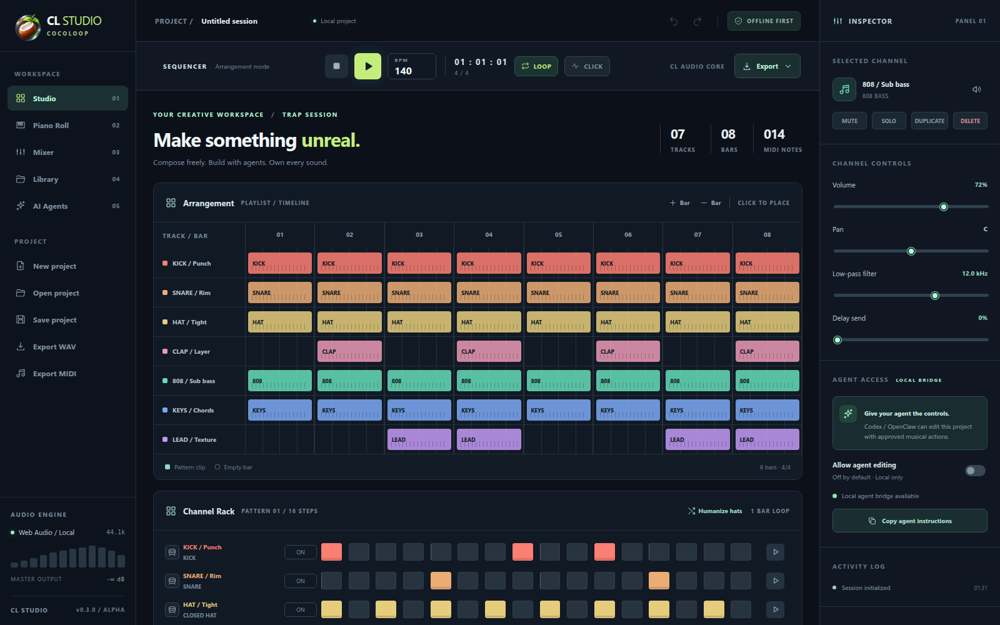

<div align="center">


# CocoLoop · CL Studio

**Un DAW local-first de código abierto que los agentes pueden editar de verdad.**

[](https://github.com/smouj/cocoloop/actions/workflows/ci.yml)
[](https://github.com/smouj/cocoloop/releases)
[](LICENSE)
[](https://www.python.org/)

[English](README.md) · [Inicio rápido](#inicio-rápido) · [Agentes](#agentes) · [Arquitectura](docs/ARCHITECTURE.md) · [Roadmap](docs/ROADMAP.md)

</div>

> **Alpha 0.3.0.** Un DAW funcional en ventana de escritorio, con servidor local incluido y un perfil de estudio predeterminado. No es un sustituto completo de FL Studio. Sin cuentas, sin nube, sin telemetría y sin necesidad de instalar Python para la app de Windows. Todo el audio, los proyectos y las exportaciones se quedan en tu equipo.



## Qué incluye

- Arreglo de 1–32 compases, secuenciador de 16 pasos, Piano Roll con velocidad y longitud de nota, mezclador con fader maestro y inspector.
- Diez instrumentos sintetizados originales (batería, 808, teclas, lead, pad y sampler de audio).
- Reproducción con Web Audio, metrónomo y medidor estéreo.
- Exportación WAV estéreo 16 bits / 44,1 kHz y MIDI estándar; proyectos portables `.clstudio.json`.
- Integración con Codex (MCP stdio) y OpenClaw (CLI) mediante acciones musicales validadas, consentimiento humano y deshacer compartido.
- Historial de undo/redo para cambios humanos y de agentes; los lotes son atómicos.
- **App de escritorio** con ventana nativa, menú, acceso directo y servidor/MCP/CLI incluidos.
- **Librería predeterminada** con 3 plantillas, 7 patrones, 4 presets de mezcla, 5 plugins y 2 perfiles de agente.

## Inicio rápido

### App de escritorio para Windows (recomendada)

1. Descarga `CocoLoop-Setup-0.3.0.exe` desde [Releases](https://github.com/smouj/cocoloop/releases/tag/v0.3.0).
2. Ejecuta el instalador: instala por usuario, crea el acceso directo **CocoLoop** en el escritorio y abre la app.
3. Entra en **Library** para usar el perfil predeterminado, plantillas, patrones, presets y plugins.

La app instalada no necesita Python ni Node: el servidor local, el adaptador MCP y el CLI van incluidos.

### ZIP portable para Windows

1. Descarga el ZIP desde [Releases](https://github.com/smouj/cocoloop/releases/tag/v0.3.0).
2. Extrae, por ejemplo, en `C:\CocoLoop`.
3. Instala [Python 3.10+](https://www.python.org/) si no lo tienes.
4. Abre `start-windows.bat` o ejecuta `py server.py --open`.

### Linux / macOS

```sh
git clone https://github.com/smouj/cocoloop.git
cd cocoloop
python3 server.py --open
```

Abre <http://127.0.0.1:38475>, pulsa **Play** y empieza a editar. No hay que compilar ni instalar dependencias.

## Agentes

El puente solo expone acciones musicales; nunca shell, red ni acceso arbitrario al sistema de archivos.

```powershell
codex mcp add cocoloop-cl-studio -- py C:\CocoLoop\bridge\mcp_server.py
```

```sh
python3 bridge/clctl.py project
python3 bridge/clctl.py action '{"type":"set_tempo","bpm":128}'
```

Activa **Allow agent editing** en el inspector: está desactivado por defecto y se reinicia al recargar. Consulta [docs/AGENT-API.md](docs/AGENT-API.md) y [docs/AGENTS.md](docs/AGENTS.md).

## Seguridad

- El servidor escucha solo en `127.0.0.1` y valida la cabecera `Host`.
- Las escrituras de agentes requieren un token Bearer en `~/.cocoloop/agent-token` y consentimiento en la interfaz.
- Las respuestas incluyen CSP restrictiva, `nosniff`, `DENY` y política sin referrer.
- **No ha sido auditado de forma independiente.** No expongas el puerto a Internet. Lee [SECURITY.md](SECURITY.md).

## Estado

Alpha 0.3.0 utilizable para bocetos, experimentos de sonido, demos de agentes y docencia. El instalador de esta versión no está firmado digitalmente. El [roadmap](docs/ROADMAP.md) describe el camino a v1: variantes de patrón, automatización, autoguardado con muestras en IndexedDB, latencia, instaladores firmados y auditoría de seguridad.

## Licencia y marca

Código y documentación bajo [MIT](LICENSE). **CocoLoop** es el producto y **CL Studio** la aplicación. El emblema ilustrado pertenece al titular del proyecto; el SVG de `branding/` es una reinterpretación vectorial simplificada. FL Studio e Image-Line son marcas de sus respectivos propietarios; este proyecto no está afiliado a ellos ni incluye recursos propietarios.
