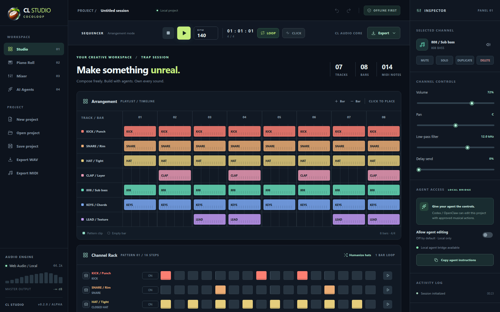
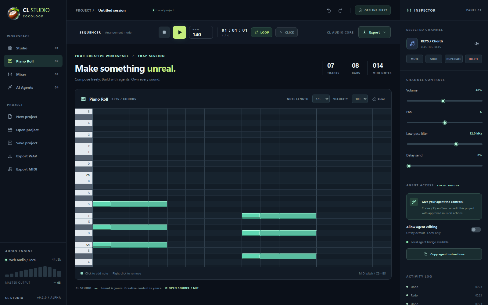
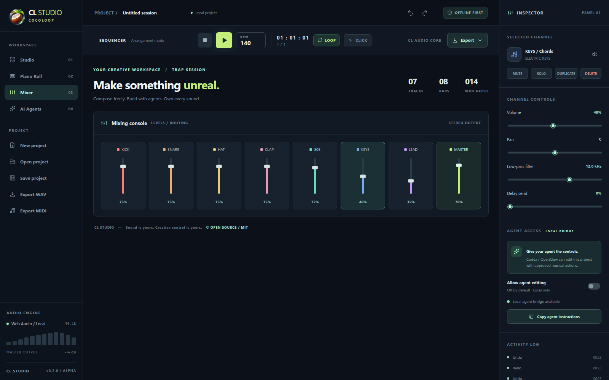
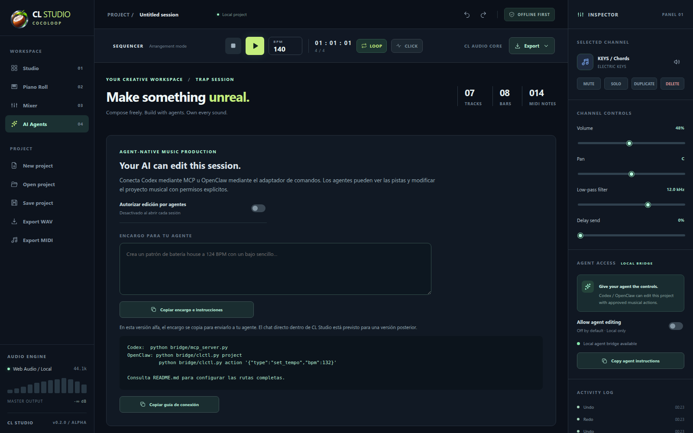
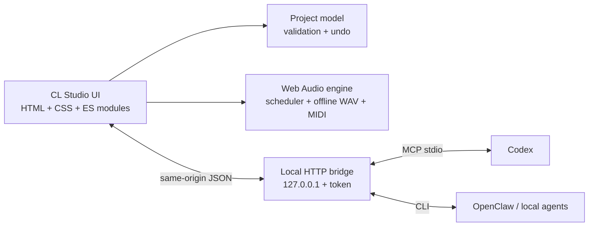

<div align="center">


# CocoLoop · CL Studio

**A local-first, open-source DAW that agents can actually edit.**

[](https://github.com/smouj/cocoloop/actions/workflows/ci.yml)
[](https://github.com/smouj/cocoloop/releases)
[](LICENSE)
[](https://www.python.org/)
[](https://developer.mozilla.org/docs/Web/API/Web_Audio_API)
[](#security-model)
[](CONTRIBUTING.md)

[Quick start](#quick-start) · [Features](#features) · [Agents](#agent-native-editing) · [Architecture](#architecture) · [Roadmap](docs/ROADMAP.md) · [Español](README.es.md)

</div>

> **Alpha 0.2.0.** A working browser DAW with a local Python bridge — not a feature-complete FL Studio replacement and not a native installer. No account, no cloud, no telemetry, no required package installs. Every sound, project and export stays on your machine.



## Why CocoLoop

Most DAWs are closed, heavy and cloud-adjacent. Most "AI music" tools generate audio you cannot inspect or edit. CocoLoop takes a third path:

- **Local-first by construction.** The UI is static files; the bridge binds to `127.0.0.1`; exports are rendered by your browser.
- **Agent-native, not agent-themed.** Codex and OpenClaw edit the *same* project state through a small, validated action schema — with explicit consent, atomic batches and undo.
- **Zero runtime dependencies.** Python 3.10+ standard library and a modern browser. No `npm install`, no Docker, no API keys.
- **Yours to fork.** MIT code, original synthesized instruments, original visual identity, portable JSON projects.

## Features

| Area | What works today |
|---|---|
| **Arrangement** | 1–32 bars, 4/4, per-track pattern clips, live playhead |
| **Channel Rack** | 16-step sequencer per track, mute, preview, humanize |
| **Piano Roll** | MIDI note entry, note length, velocity, right-click delete |
| **Mixer** | Per-track volume, pan, low-pass, delay send, master fader |
| **Instruments** | Kick, snare, hat, clap, perc, 808 bass, electric keys, lead, pad, audio sampler |
| **Audio engine** | Web Audio lookahead scheduling, metronome, stereo compressor and meter |
| **Export** | Stereo 16-bit / 44.1 kHz WAV, Standard MIDI File, portable `.clstudio.json` |
| **Undo** | Shared undo/redo history for human and agent edits |
| **Agents** | Local MCP stdio server (Codex), CLI adapter (OpenClaw), 14 validated action types |
| **Platforms** | Windows 10/11, Linux and macOS with any modern Chromium/Firefox browser |

## Quick start

### Windows

1. Download the latest ZIP from [Releases](https://github.com/smouj/cocoloop/releases).
2. Extract it, for example to `C:\CocoLoop`.
3. Install [Python 3.10+](https://www.python.org/) if needed.
4. Double-click `start-windows.bat`, or run:

```powershell
py server.py --open
```

### Linux / macOS

```sh
git clone https://github.com/smouj/cocoloop.git
cd cocoloop
python3 server.py --open
```

Open <http://127.0.0.1:38475>. Press **Play**, edit a few steps, then **Export WAV**.

No build step. No package manager. The browser asks for one click before audio starts.

## Agent-native editing

CL Studio exposes a deliberately small surface: musical actions, never shell, file-system or network commands.

```text
Codex ── MCP stdio ──┐
                     ├── 127.0.0.1 HTTP + bearer token ── CL Studio UI
OpenClaw ── CLI ─────┘                                   (consent required)
```

1. Start the studio and open it in your browser.
2. Switch on **Allow agent editing** in the Inspector. It is off by default and resets on reload.
3. Connect an agent:

```powershell
# Codex (absolute path)
codex mcp add cocoloop-cl-studio -- py C:\CocoLoop\bridge\mcp_server.py
codex mcp list
```

```sh
# Linux / macOS
codex mcp add cocoloop-cl-studio -- python3 /ABSOLUTE/PATH/bridge/mcp_server.py

# OpenClaw or any local agent with exec permission
python3 bridge/clctl.py project
python3 bridge/clctl.py action '{"type":"set_tempo","bpm":128}'
python3 bridge/clctl.py batch-file actions.json
```

The MCP server exposes `cl_get_project` and `cl_apply_actions`. Read first, then submit 1–64 actions. A batch is all-or-nothing and becomes one undo step. See [docs/AGENT-API.md](docs/AGENT-API.md).

```json
[
  {"type":"set_tempo", "bpm":136},
  {"type":"set_steps", "track_id":"EXISTING_KICK_ID", "steps":[0,4,8,12]},
  {"type":"set_track", "track_id":"EXISTING_KICK_ID", "field":"volume", "value":0.85}
]
```

## Gallery

| Piano Roll | Mixer |
|---|---|
|  |  |

| Agent workspace | Brand |
|---|---|
|  |  |

## Architecture



- `app/model.js` — pure project schema, validation, atomic actions, undo-friendly copies.
- `app/audio.js` — synth voices, scheduling, WAV encoder, MIDI writer.
- `app/main.js` — UI rendering and event wiring.
- `server.py` — static server, authenticated command queue, security headers.
- `bridge/` — MCP stdio adapter, Python client and CLI.

Read [docs/ARCHITECTURE.md](docs/ARCHITECTURE.md) for invariants and extension points.

## Project format

Projects are portable JSON (`schema: "clstudio.project"`, version 1). Legacy `.alstudio.json` files are imported and converted in memory. Samples are embedded as data URLs in exported projects; browser autosave omits them intentionally.

**Documented limits:** one 16-step pattern per track, fixed 4/4, no VST hosting, no live recording, one active browser tab, 12 MB per sample, 22 MB per project file, WAV tail limited to 1.5 s after the arrangement.

## Testing

```sh
npm test                        # or: node tests/model_test.mjs && python3 -m unittest ...
python3 tests/browser_smoke.py  # needs a running server + Playwright
```

The suite covers immutable action batches, every documented action, schema limits, WAV headers, MIDI channel routing, HTTP authorization, CSP headers, host validation and MCP initialization. CI runs the model tests on Node 22/24, Python tests on 3.10–3.13, and a real headless Chromium smoke test on Linux.

## Security model

- Server binds **only** to `127.0.0.1` and validates the `Host` header.
- Agent writes require a bearer token stored at `~/.cocoloop/agent-token` (mode `0600`).
- Agent mutation requires a human consent toggle in the open UI.
- The UI accepts only a documented, bounded action schema; unknown fields and operations are rejected.
- Static and API responses carry a restrictive Content-Security-Policy, `nosniff`, `DENY` framing and a no-referrer policy.
- **Not independently audited.** Do not expose the port through a reverse proxy or the public Internet. See [SECURITY.md](SECURITY.md).

## Status and roadmap

Alpha 0.2.0 is usable for sketching, sound design experiments, agent demos and teaching. The [roadmap](docs/ROADMAP.md) tracks the path to a reliable v1: pattern variants and automation, IndexedDB sample autosave, latency work, a Tauri desktop shell, signed installers and an independent security review.

## Contributing

Issues and pull requests are welcome. Read [CONTRIBUTING.md](CONTRIBUTING.md) and the [Code of Conduct](CODE_OF_CONDUCT.md). Good first issues: accessibility, Spanish/English UI copy, additional original synth presets, and browser compatibility reports.

## Brand and license

**CocoLoop** is the product; **CL Studio** is the application. The illustrated emblem is provided by the project owner; the SVG in `branding/` is a simplified original reinterpretation. See [branding/BRAND-GUIDE.md](branding/BRAND-GUIDE.md).

Code and documentation are [MIT licensed](LICENSE). FL Studio and Image-Line are trademarks of their respective owners; this project is not affiliated with them and contains no proprietary assets.

<div align="center">

**Make something unreal. Own every sound.**

</div>
